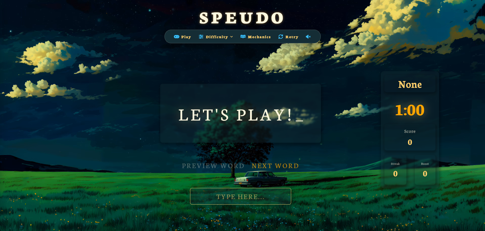

# Speudo

A fast-paced browser typing game. Type each word as it appears, build a streak to boost your multiplier, and rack up the highest score before the clock runs out.

Built with vanilla HTML, CSS, and JavaScript (ES modules). No frameworks, no build step.



---

## Features

- **Three difficulty levels** with different word lengths and score weighting
- **Live word queue** showing the current word plus the next two
- **Streak and multiplier system** that rewards accuracy
- **3-2-1 countdown** before each round, then a timed round
- **Game-over popup** with your final score and a one-click Play Again
- **Retry from the nav bar** at any time, even mid-round
- **Words loaded from an API**, so the word pool is not hardcoded
- **Responsive layout** that scales fluidly between 990px and large desktop monitors
- **Mechanics panel** that explains the rules in-game

## How to Play

1. Click **Play** (starts on Easy) or open **Difficulty** and pick a level.
2. Wait for the 3-2-1 countdown.
3. Type the word shown in the main box and press **Enter**.
4. Keep typing correctly to grow your streak. A mistake resets it.
5. When the timer hits 0:00, your final score is shown. Hit **Play Again** to go again at the same difficulty.

### Difficulty Levels

| Difficulty | Word Length   | Score Multiplier |
|------------|---------------|------------------|
| Easy       | 4-5 letters   | x1               |
| Medium     | 8-10 letters  | x2               |
| Hard       | 13-15 letters | x3               |

### Scoring

Each correct word earns:

```
points = word length x difficulty multiplier x streak multiplier
```

| Current Streak | Streak Multiplier |
|----------------|-------------------|
| 0-2 words      | x1                |
| 3-5 words      | x2                |
| 6+ words       | x3                |

A wrong submission resets your streak (and multiplier) back to the start. Your score is kept.

---

## Tech Stack

- **HTML5**
- **CSS3** (flexbox, `clamp()` for fluid sizing, CSS animations)
- **JavaScript (ES modules)**, organized into small classes and modules
- **[Font Awesome](https://fontawesome.com/)** for icons
- **[Neuton](https://fonts.google.com/specimen/Neuton)** via Google Fonts
- **Sikyord** as an API proxy for fetching the word lists

## Getting Started

### Prerequisites

- A modern desktop browser
- [VS Code](https://code.visualstudio.com/) with the **Live Server** extension (or any local static server)

> ES modules (`import` / `export`) are blocked by browsers when a page is opened directly from the file system (`file://`). You must serve the project over `http://`.

### Installation

1. Clone the repository:
   ```bash
   git clone https://github.com/<your-username>/<your-repo>.git
   cd <your-repo>
   ```

2. Create a `configs.js` file in the project root. It is not included in the repo. Use this template:
   ```js
   export const SIKYORD_API_KEY = "your-sikyord-key";
   export const SIKYORD_DB_ENDPOINT = "your-sikyord-db-endpoint";
   export const SIKYORD_AI_ENDPOINT = "your-sikyord-ai-endpoint";

   export const GROQ_AI_ENDPOINT = "https://api.groq.com/openai/v1/chat/completions";
   export const EASY_DB_ENDPOINT = "your-easy-words-endpoint";
   export const MEDIUM_DB_ENDPOINT = "your-medium-words-endpoint";
   export const HARD_DB_ENDPOINT = "your-hard-words-endpoint";
   ```

3. Open `html/index.html` with Live Server (right-click, **Open with Live Server**).

### A Note on API Keys

This is a client-side-only project, so any key used in the browser can be seen by anyone who opens DevTools. Adding `configs.js` to `.gitignore` keeps the key out of your repository history, but it does not hide it from visitors of a deployed site. Treat the Sikyord key as a low-privilege, rotatable key.

## Project Structure

```
.
├── configs.js              # API keys and endpoints (not committed)
├── html/
│   └── index.html
├── css/
│   ├── index.css           # Base styles, difficulty dropdown, page background
│   ├── nav.css             # Title and navigation bar
│   ├── hud.css             # Timer, score, streak, multiplier
│   ├── wordqueue.css       # Word queue and input
│   ├── mechanics.css       # "How to play" side panel
│   └── countdown.css       # 3-2-1 overlay and game-over popup
├── js/
│   ├── app.js              # ApiClient, WordQueue, and event wiring
│   ├── score.js            # Game state, scoring, streak logic
│   ├── timer.js            # GameClock: pre-game countdown and round timer
│   └── nav.js              # Panel open/close behavior
├── img/
└── video/
```

### How the Code Fits Together

- **`ApiClient`** fetches a short-lived key from Sikyord, then uses it to fetch the word list for the selected difficulty.
- **`WordQueue`** picks random words, renders the queue, and handles the typed input on Enter.
- **`score.js`** owns the game state (`score`, `streak`, `difficulty`) and the scoring math. It has no DOM code.
- **`GameClock`** runs the 3-2-1 countdown and the round timer, and calls an `onGameOver` callback when time runs out.
- **`WordQueue.isLocked`** blocks input during the countdown and after time expires.

## Browser Support

Designed for desktop screens **990px wide or larger**. Below that width, the game is replaced with a message asking the player to use a wider screen.

## Roadmap

- [ ] Top 10 leaderboard saved to `localStorage`, with a clear button
- [ ] Letter-by-letter typing feedback (green for correct, red for wrong) directly on the main word
- [ ] Background music for the menu and for each difficulty, with a mute toggle
- [ ] Fix global keydown focus handling so it does not interfere with keyboard navigation in the difficulty panel
- [ ] Mobile and tablet layouts

## License

Add your license here (for example, MIT).

## Acknowledgments

Built as part of a full-stack web development bootcamp project.
